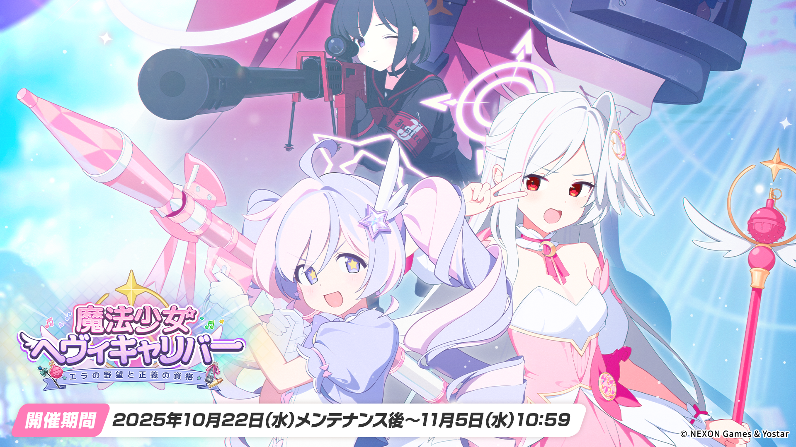
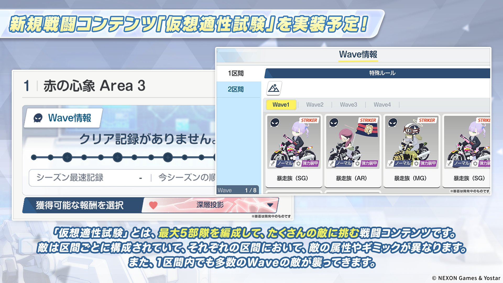
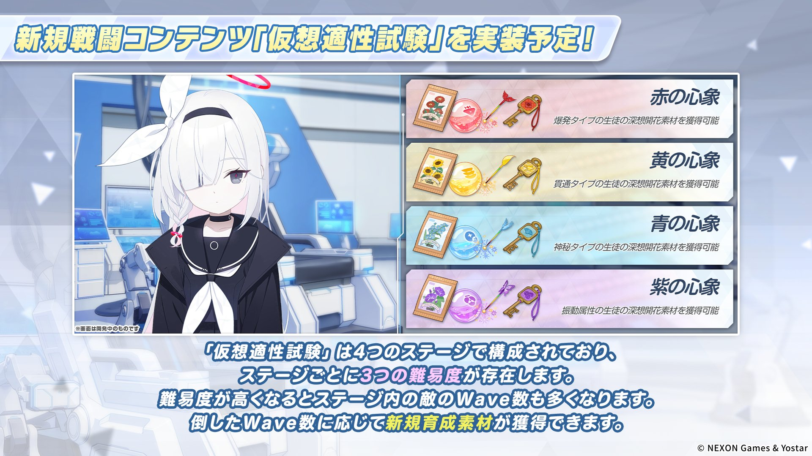
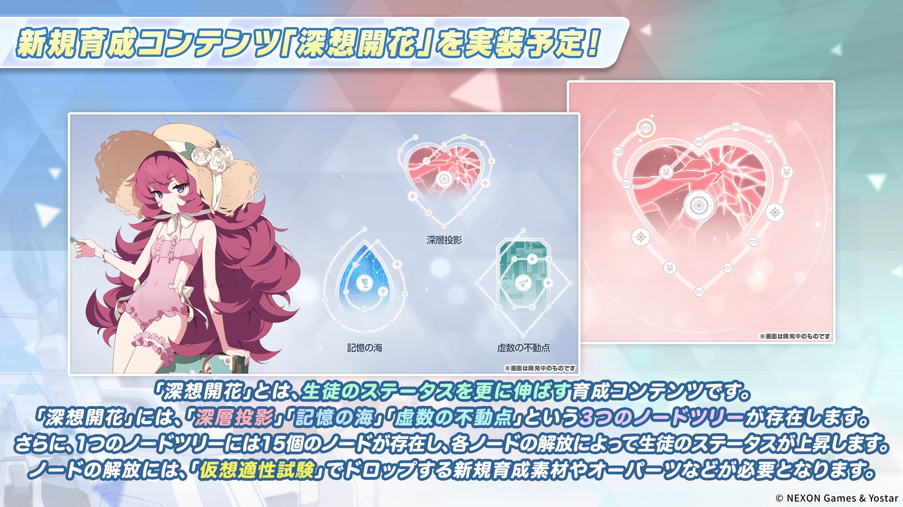
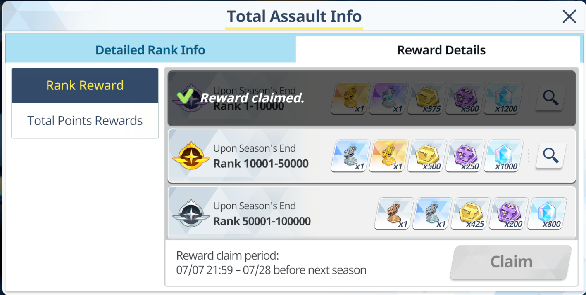
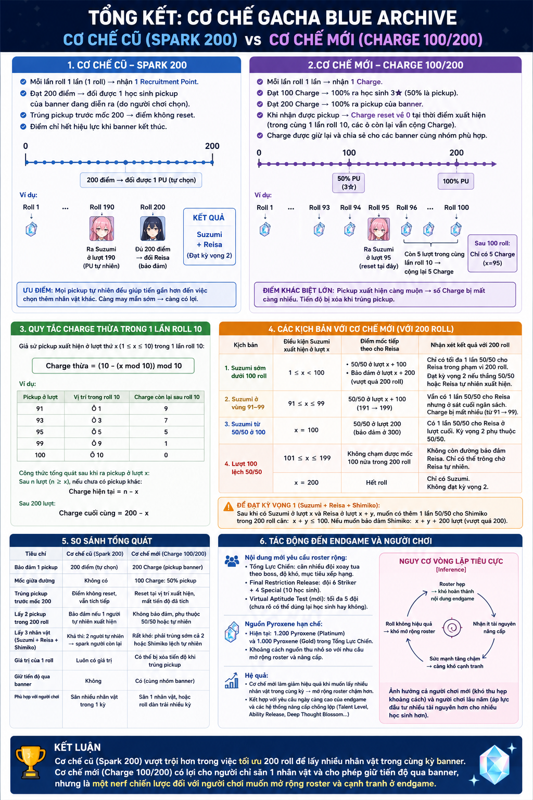

> **Cập nhật 09/11/2026.** Bài đăng ngày 26/07, viết lại theo 11 slide thuyết trình tiếng Hàn về cải tổ hệ thống chiêu mộ (server Global từ 10/11/2026), đối chiếu qua space [Blue Archive - Hệ Gacha Mới](https://muse.ai/s/blue-archive-he-gacha-moi-xqxb6z3xhoxrr62/OgIhNFlZmOPnJJn_FZusbqR2A0_FRLLQ2KTqjYpQhYI). Những chỗ sửa chính: mốc áp dụng Global thay vì mốc Nhật, tên gọi Stack/Mileage, giá thật của một lần bảo đảm, luật reset khi ra 3★ lệch, và kết luận về săn 2 pickup tính lại theo lượng đá.

Ý tưởng: tôi

Hành văn: gpt-5.6-sol (mức high, qua chat app, không phải work/codex). Đã có một chút chỉnh lí, bổ sung cho phù hợp.

Khi một hệ thống gacha tặng thêm 40 lượt quay nhưng đồng thời lấy đi quyền tự chọn ở mốc 200, câu hỏi không còn đơn giản là "được thêm bao nhiêu". Câu hỏi đúng hơn là: sau khi đã tiêu 24.000 Pyroxene, người chơi còn kiểm soát được kết quả đến mức nào?

---

## Thông tin về cơ chế mới

Áp dụng cho server **Global từ 10/11/2026**, thay thế hệ spark 200 điểm cũ. Ba điểm lớn:

- **Recruitment Point** và cơ chế dùng 200 điểm để đổi trực tiếp một pickup bị loại bỏ. Điểm tích ở banner cũ được chuyển thành Keystone Pieces, không mang sang hệ mới.
- **Recruitment Stack** được bổ sung: 100 Stack cho một học sinh 3★ với 50% khả năng là pickup; 200 Stack bảo đảm pickup của banner đang quay.
- **Recruitment Mileage Rewards** được thêm vào, trao vé 10 lượt có thời hạn và nguyên liệu theo tổng số lần tuyển dụng trong kỳ banner.

Nhìn riêng từng phần, cơ chế mới có vẻ hào phóng hơn. Người chơi có một mốc 50/50 ở lượt 100, được thêm vé quay, và Stack có thể được giữ lại theo điều kiện của từng nhóm banner.

Nhưng thay đổi quan trọng nhất lại nằm ở một dòng khác:

> Khi nhận được pickup, Stack đã tích đến đúng vị trí nhân vật xuất hiện sẽ reset về 0.

Đây là điểm khiến cơ chế mới dễ chịu hơn khi săn một mục tiêu, và khó lường hơn khi săn hai hoặc ba nhân vật trong cùng một đợt.

---

## Hai bộ đếm hoàn toàn khác nhau

Cơ chế mới sử dụng song song hai bộ đếm, và việc nhầm chúng với nhau sẽ khiến toàn bộ phép tính lệch khỏi đường ray.

### Recruitment Stack

Stack quyết định mốc pity:

- 100 Stack: chắc chắn có một học sinh 3★, với 50% khả năng là pickup.
- 200 Stack: chắc chắn nhận pickup của banner đang quay.
- Khi nhận pickup, Stack reset về 0 tại đúng vị trí nhân vật xuất hiện.
- Các lượt còn lại phía sau pickup trong cùng một lần quay 10 tiếp tục cộng Stack mới.
- Tỉ lệ thường không đổi: ngoài hai mốc trên, mỗi lần quay vẫn có 0,7% ra pickup. Stack không làm tăng tỉ lệ dần theo từng lần quay — khác với các hệ pity tăng tỉ lệ dần như Genshin.
- **Ra 3★ không phải pickup thì Stack không reset.** Kể cả 3★ ở mốc 100 rơi vào 50% còn lại, Stack vẫn chạy tiếp tới mốc 200.

### Hai Stack riêng: thường và đặc biệt / FES

Không có một Stack chung cho mọi banner. Stack chia hai loại, và hai loại không cộng chéo:

- **Stack thường**: banner pickup thường, kể cả rerun. Hai banner thường A (20 lần) và B (30 lần) mở cùng kỳ thì cộng chung thành 50.
- **Stack đặc biệt / FES**: banner pickup đặc biệt và FES, kể cả rerun. Banner C (40 lần) và D (50 lần) cộng chung thành 90.
- Quay 50 lần banner thường không làm Stack FES nhích lên dù chỉ 1 lần.
- Trong mỗi loại, các banner mở cùng thời gian đổ số lần quay vào chung một Stack. Ra pickup ở banner nào thì Stack của loại đó reset.

### Stack mang sang banner sau

Chưa ra pickup thì Stack giữ nguyên và nối tiếp sang banner cùng loại ở kỳ sau. Ví dụ: quay 40 lần mỗi event, 3 event cùng loại, không ra pickup — Stack đi 0 → 40 → 80 → 120, chạm mốc 100 ngay ở lần quay thứ 20 của event thứ ba.

Những lượt quay "lỡ cỡ, không ra gì" ở banner trước không mất trắng nữa. Đây là khác biệt thực tế lớn nhất so với hệ cũ, nơi điểm hết banner là hết giá trị.

### Recruitment Mileage Rewards

Mileage chỉ đếm tổng số lần quay trong **kỳ pickup hiện tại**:

- Quay pickup 1 lần = 1 Mileage, tính chung cho các banner pickup trong cùng kỳ.
- Được chia sẻ giữa các pickup chạy cùng kỳ.
- Không được mang sang kỳ pickup tiếp theo. Hết kỳ, Mileage về 0 — vé và quà chưa chạm mốc thì mất.
- Sang kỳ mới, phần thưởng "lần đầu" từ mốc 10 lại có thể nhận lại.
- Archive Recruitment và một số hình thức tuyển dụng bằng sản phẩm trả phí không được tính.

Nói cách khác, Stack là pity dài hạn, biết "nhớ" qua banner; Mileage là một đường thưởng theo kỳ. Hai thứ đứng cạnh nhau trên giao diện nhưng sống hai cuộc đời riêng.

---

## Phần thưởng lượt quay thực sự bù được bao nhiêu?

Bảng thưởng đầy đủ, 20 mốc đầu tiên:

| Mốc (lần) | Phần thưởng |
| --- | --- |
| 10 | Hộp chọn BD Chiến thuật Cao cấp ×2 |
| 30 | Eligma ×10 |
| 50 | Hộp chọn Sổ Kỹ thuật Cao cấp ×5 |
| 70 | **Vé chiêu mộ ×10 (có thời hạn)** |
| 90 | Hộp quà tặng ×2 |
| 110 | Eligma ×20 |
| 130 | **Vé chiêu mộ ×10 (có thời hạn)** |
| 150 | **Vé chiêu mộ ×10 (có thời hạn)** |
| 170 | **Vé chiêu mộ ×10 (có thời hạn)** |
| 190 | Hộp chọn Sổ Kỹ thuật Tối thượng ×5 |
| 210 | Hộp chọn BD Chiến thuật Cao cấp ×2 |
| 230 | Eligma ×10 |
| 250 | Hộp chọn Sổ Kỹ thuật Cao cấp ×5 |
| 270 | **Vé chiêu mộ ×10 (có thời hạn)** |
| 290 | Hộp quà tặng ×2 |
| 310 | Eligma ×20 |
| 330 | **Vé chiêu mộ ×10 (có thời hạn)** |
| 350 | **Vé chiêu mộ ×10 (có thời hạn)** |
| 370 | **Vé chiêu mộ ×10 (có thời hạn)** |
| 390 | Hộp chọn Sổ Kỹ thuật Tối thượng ×5 |

Trước mốc 200, người chơi nhận 4 vé 10 lượt, tương đương 40 lượt quay. Trước mốc 390 là 8 vé, tương đương 80 lượt — mức tối đa một kỳ. Sau mốc 390, thưởng chuyển sang dạng lặp, cứ mỗi 20 lần lại có thưởng, nhưng không còn vé 10 lượt.

Vé có thời hạn, và khi quay tiếp nối, vé được tự động dùng trước Pyroxene. Tám vé đầu vì thế là khoản hoàn trả một lần trong mỗi kỳ pickup; sang kỳ mới, dãy thưởng đầu lại reset từ mốc 10. Đây không phải máy in vé vô hạn.

### Giá thật của một lần bảo đảm

Bắt đầu từ Stack 0, Mileage 0, quay liên tục trong một kỳ tới mốc bảo hiểm 200: trên đường đi đã nhận 4 vé ở các mốc 70, 130, 150, 170, tức 40 lần quay bằng vé.

```
Tổng vẫn là 200 lần để chắc chắn có pickup
Phần phải trả bằng đá chỉ còn 160 lần
160 × 120 = 19.200 Pyroxene, thay vì 24.000
```

Trần của một lần bảo đảm vì thế đã hạ từ 24.000 xuống 19.200 đá — 24.000 chỉ còn là ngân sách tối đa cho 200 lần đá, tương ứng tổng 240 lượt quay trong kỳ.

---

## Cách đọc xác suất: con số 24,5% từ đâu ra

Mỗi lần quay, xác suất không ra pickup là 100% − 0,7% = 99,3%, tức 0,993. Hụt liên tiếp 200 lần:

```
0,993^200 ≈ 24,5%
```

Đó là xác suất quay 200 lần vẫn trắng tay ở hệ cũ — cứ 4 người thì khoảng 1 người rơi vào trường hợp này. Chính vì có tới khoảng 24,5% người chơi quay đủ 200 lần vẫn hụt, hệ cũ mới cần spark: đủ 200 điểm thì đổi thẳng học sinh, đảm bảo không ai trắng tay hoàn toàn.

Định hướng của đợt cải tổ là thu nhỏ vùng "quay mãi không ra" này bằng hai cơ chế: mốc bảo hiểm Stack 100/200 và vé Mileage. Đường cong này chưa tính luật bảo hiểm của Stack và hiệu ứng vé Mileage — nó chỉ là xác suất tích lũy thuần túy ở tỉ lệ 0,7%/lần.

---

## Săn 1 pickup: hệ mới hơn hẳn, nhưng phải đọc đúng trục

Có hai cách đo, cho hai con số khác nhau — cả hai đều đúng, vì khác thước đo.

### Theo tổng số lần quay (P.06)

- Trong 100 lần quay: cũ ≈ **50,5%**, mới ≈ **75,1%** — và phần đá thực chi mới là 90 lần, vì vé ở mốc Mileage 70 lo 10 lần còn lại.
- Cú nhảy ở lần thứ 100: ngay trước mốc 100, xác suất còn hụt là ≈ 49,9% (sau 99 lần). Đến lần thứ 100, chắc chắn ra 3★ và 3★ đó có 50% là pickup — một nửa số người còn hụt được "cứu" ngay tại chỗ, xác suất hụt rơi xuống ≈ 24,9%.
- Sau mốc 100, đường cong chạy tiếp với tỉ lệ thường; ở lần thứ 200, mốc 200 đóng đinh: chắc chắn ra đúng pickup, xác suất hụt về 0.

### Theo lượng đá tiêu (P.07) — phép so sánh công bằng nhất

- Cùng 100 lần đá: cũ ≈ **50,5%**, mới ≈ **76,7%** — vì 100 lần đá cho ra tổng 110 lần quay (100 đá + 10 vé của mốc Mileage 70), và đã đi qua mốc bảo hiểm 100.
- Đá trung bình tới pickup đầu tiên: ≈ **108 → ≈ 79 lần**, giảm gần 30 lần.
- Bảo hiểm cứng: đá 160 + vé 40 = lần tích lũy 200.

Chênh lệch giữa 75,1% (P.06) và 76,7% (P.07) không phải hai nguồn mâu thuẫn nhau: P.06 cố định tổng số lượt quay ở 100 (đá chỉ 90 lần), còn P.07 cố định số đá ở 100 lần (tổng lượt quay thành 110). Đọc phần trăm nào cũng phải đọc kèm trục ngang của nó.

---

## Săn 2 pickup: chỗ duy nhất hệ mới "thua" — và nó là cái bẫy đọc số

### Mốc tham chiếu hệ cũ (P.08)

Nhắm cả hai học sinh pickup của một kỳ, mỗi banner một người:

- Tại mốc 200 lần: ≈ **75,5%** đủ cả hai. Logic: spark ở 200 điểm đảm bảo một người; người còn lại buộc phải ra bằng tỉ lệ thường trước đó.
- Tại mốc 400 lần: **100%**. Spark thứ hai ở điểm 400 lo nốt người còn lại.

### Theo tổng số lần quay (P.09) — slide dễ bị cắt khỏi ngữ cảnh nhất

Tổng 200 lần quay: cũ ≈ **75,5%**, mới ≈ **64,1%**. Nhưng hai con số này không cùng lượng đá: 200 lần của hệ cũ là 200 lần đá, còn 200 lần của hệ mới chỉ gồm 160 lần đá + 40 lần vé. Chính slide gốc cũng ghi cảnh báo: "Lượng Pyroxene đã dùng của hai bên khác nhau".

Đếm theo lượt quay và dừng đúng ở 200, spark cũ cho một cú nhảy rất đúng lúc — đảm bảo luôn một người tại đúng mốc đó — còn hệ mới thì mỗi người có một Stack, người thứ hai phải làm lại hành trình của riêng mình. Đổi lại, phía hệ mới mới chỉ tốn 160 lần đá cho 200 lượt quay đó.

### Theo lượng đá tiêu (P.10) — phép so sánh công bằng

- Cùng 200 lần đá: cũ ≈ **75,5%**, mới ≈ **76,8%** — 200 lần đá này cho tổng 240 lần quay (200 đá + 40 vé đã nhận và dùng trên đường).
- Trần cứng cho đủ cặp: **đá 320 + vé 80**, tức lần tích lũy thứ 400 thì đủ cả hai.
- Theo mô hình của slide, đường hệ mới bằng hoặc cao hơn hệ cũ trên toàn dải đá 1–400 lần.
- Chênh lệch khi săn 2 người nhỏ hơn hẳn khi săn 1 người — chỉ +1,3 điểm % ở mốc 200 đá, so với +26,2 điểm % ở P.07 — vì Stack reset sau mỗi pickup, lợi thế mốc 100/200 phải "kiếm lại" cho từng người.

Điều kiện mô hình P.08–P.10: tỉ lệ pickup 0,7%/lần; ra học sinh đầu tiên thì chuyển ngay sang banner học sinh còn lại; không tính việc học sinh còn lại tự xuất hiện lệch banner; bắt đầu từ 0, không có vé hay lượt miễn phí có sẵn; vé nhận trong kỳ được dùng nối tiếp và tự động ưu tiên trước đá.

---

## Bài toán Magical Girl Heavy Caliber



Giả sử một đợt rerun có ba mục tiêu:

- **Magical Suzumi**, giới hạn.
- **Magical Reisa**, giới hạn.
- **Magical Shimiko**, nhân vật thường và có thể lệch ra sau.

Người chơi có 24.000 Pyroxene = 200 lượt bằng đá, tối đa 240 lượt thực tế trong kỳ sau bốn vé thưởng.

Hai mức mục tiêu:

- **Kỳ vọng 1:** lấy Suzumi, Reisa và Shimiko.
- **Kỳ vọng 2:** lấy Suzumi và Reisa; Shimiko có thể để lệch ra sau.

Ở đây, "kỳ vọng" chỉ có nghĩa là mục tiêu mong muốn, không phải giá trị kỳ vọng theo thống kê.

### Cơ chế cũ

Trong cơ chế cũ, mỗi lượt quay tạo ra 1 Recruitment Point. Đạt 200 điểm, người chơi có thể đổi trực tiếp một pickup đang diễn ra. Điểm mạnh nhất là:

> Trúng pickup không làm mất số điểm đã tích.

May mắn không chỉ đem đến một nhân vật — nó còn làm mốc spark 200 mạnh hơn. Chỉ cần một trong hai nhân vật giới hạn xuất hiện tự nhiên trong 200 lượt, nhân vật còn lại đã có thể được khóa bằng spark. Suzumi xuất hiện ở lượt 190 cũng vậy: quay thêm 10 lượt là đủ 200 điểm để đổi Reisa.

### Cơ chế mới

Với cơ chế mới, 24.000 Pyroxene có thể tạo ra tối đa 240 lượt thực tế nhờ bốn vé 10 lượt. Nghe rất hấp dẫn — nhưng 240 lượt quay và một quyền chọn ở mốc 200 là hai loại giá trị hoàn toàn khác nhau.

Gọi `x` là vị trí Suzumi xuất hiện. Ngay tại lượt `x`, Stack về 0. Nếu pickup xuất hiện trong một lượt quay 10, các ô phía sau tiếp tục cộng Stack mới; lượng Stack còn lại sau khi hoàn tất lượt quay 10 đó là `(10 - (x mod 10)) mod 10` — Suzumi ở lượt 93 thì còn 7 Stack, ở lượt 99 thì còn 1, ở lượt 100 thì còn 0.

Dù còn vài Stack lẻ, mốc pity tiếp theo vẫn tính từ đúng vị trí pickup:

```
Mốc 50/50 tiếp theo = x + 100
Mốc bảo đảm tiếp theo = x + 200
```

Với tổng ngân sách 240 lượt trong kỳ:

```
Có thể chạm 50/50 cho nhân vật thứ hai nếu x ≤ 140
Có thể bảo đảm nhân vật thứ hai nếu x ≤ 40
```

Hai ngưỡng này đúng — nhưng chỉ trong phạm vi một kỳ, với ngân sách 200 lần đá. Và chúng chưa kể hết câu chuyện. Thứ nhất, pickup đầu tiên được bảo đảm ở lần tích lũy 200, tốn 160 lần đá chứ không phải 200, nên ngưỡng `x ≤ 40` nói về vị trí tích lũy, không phải số đá đã đốt. Thứ hai, trượt mốc trong kỳ này không xóa tiến độ: Stack tích lại cho Reisa sau khi reset được mang sang banner cùng loại ở kỳ sau, trong khi điểm spark cũ hết banner là hết giá trị. Thứ ba — và quan trọng nhất — xác suất ở cùng lượng đá thì hệ mới không thua: như P.10 đã tính, cùng 200 lần đá, đủ cả hai pickup là 76,8% so với 75,5% của hệ cũ. Cái hệ mới mất là quyền chọn chắc chắn, không phải xác suất.

Nói gọn lại: "không đạt kỳ vọng nào" nên hiểu là "không còn con đường bảo hiểm để đạt kỳ vọng trong kỳ này"; "kỳ vọng 1 bị loại bỏ" nên hiểu là "kỳ vọng 1 không còn khả năng được chủ động bảo đảm". Còn "24.000 Pyroxene chỉ có 200 lượt" thì phải đọc là "200 lượt bằng đá, tối đa 240 lượt thực tế sau bốn vé thưởng".

---

## Theo kiểu người chơi: ai lợi nhất, ai là ngoại lệ duy nhất (P.11)

Slide cuối quy mọi thứ về một đơn vị dễ so nhất: số lần quay bằng Pyroxene tính cho một học sinh — con số càng nhỏ, kiểu chơi đó càng tốn ít đá.

| Kiểu người chơi | Cũ | Mới | Thay đổi |
| --- | --- | --- | --- |
| Chia nhỏ, mỗi đợt quay dưới 70 lần (lần nhận đầu tiên) | ≈ 143 lần | ≈ 90 lần | −36,9% đá |
| Gom đủ 200 lần, quay một mạch (lần nhận đầu tiên) | ≈ 108 lần | ≈ 79 lần | −26,7% đá |
| Quay trùng cùng một học sinh, ngân sách 400 lần đá (giá cho mỗi bản sao kỳ vọng) | ≈ 83 lần | ≈ 79 lần | −4,8% đá |
| Quay trùng cùng một học sinh, ngân sách 1000 lần đá (giá cho mỗi bản sao kỳ vọng) | ≈ 83 lần | ≈ 85 lần | **+2,5% đá** |

Lợi nhất: người quay chia nhỏ, mỗi đợt dưới 70 lần (−36,9%) — nhóm bị hệ cũ "xé lẻ" tiến độ nặng nhất: điểm hết banner là hết giá trị, còn Stack thì nhớ hết và mang sang. Lợi rõ rệt: người gom 200 quay một mạch (−26,7%), khớp con số 108 → 79 lần đá ở P.07. Lợi ít dần khi quay trùng lặp nặng: ở ngân sách 400 lần đá chỉ còn −4,8%, vì sau mỗi lần ra pickup, Stack reset và phải leo lại từ đầu, vé bị khóa trần 80 lần/kỳ, thưởng lặp sau mốc 390 không có vé.

Ngoại lệ duy nhất: ngân sách 1000 lần đá để quay trùng, +2,5%. Đây là trường hợp duy nhất trong cả bộ slide mà hệ mới tốn đá hơn hệ cũ theo giá trị tính toán — người "đập đá" cực sâu vào một học sinh gần như luôn chạm trần bảo hiểm ở cả hai hệ, lợi thế vé bị pha loãng trên 1000 lần, còn spark cũ đổi điểm đều tay theo từng 200 điểm lại nhỉnh hơn một chút.

Lưu ý về cách đọc bảng: hai hàng trên là giá trị kỳ vọng của số đá cần để có lần nhận đầu tiên (quay đến khi ra pickup thì dừng); hai hàng dưới lấy ngân sách đá cố định (400 / 1000 lần) chia cho số học sinh kỳ vọng nhận được khi quay trùng lặp cùng một học sinh trong một kỳ. Số lần trung bình được làm tròn lên thành số nguyên khi hiển thị, còn phần trăm tăng/giảm được tính từ giá trị chưa làm tròn — nên đừng tự lấy 90/143 ra −36,9% khít tuyệt đối.

Giới hạn của bảng: các con số này chưa tính lượng tài nguyên Eleph / Eligma nhận được — đó là một khoản khác, không nằm trong phép tính "đá cho một học sinh".

---

## So sánh trực tiếp hai cơ chế

| Tiêu chí | Cơ chế cũ | Cơ chế mới |
| --- | --- | --- |
| Ngân sách 24.000 Pyroxene | 200 lượt | Tối đa 240 lượt nhờ bốn vé thưởng |
| Giá một lần bảo đảm | 200 lượt đá (24.000 đá) | 160 lượt đá (19.200 đá) + 40 vé |
| Mốc giữa đường | Không có | 100 Stack: 3★, 50% pickup |
| Mốc bảo đảm một pickup | 200 lượt, được chọn | 200 Stack, pickup của banner đang quay |
| Khi trúng pickup | Điểm vẫn giữ nguyên | Stack reset tại đúng vị trí pickup |
| Ra 3★ lệch | Điểm vẫn giữ nguyên | Stack vẫn giữ nguyên, chạy tiếp tới 200 |
| Hết banner, chưa ra pickup | Điểm mất giá trị đổi | Stack mang sang banner cùng loại kỳ sau |
| Pickup ở lượt 190 | Thêm 10 lượt để đổi người thứ hai | Còn tối đa 50 lượt, không có pity tiếp theo trong kỳ — nhưng Stack tích lại được mang sang |
| Bảo đảm hai pickup | Có, nếu một người tự xuất hiện trong 200 lượt | Chỉ có nếu pickup đầu xuất hiện không muộn hơn lượt 40 (trong một kỳ, ngân sách 200 lần đá) |
| Đủ cả hai, cùng 200 lần đá | ≈ 75,5% | ≈ 76,8% |
| Trần cứng đủ cặp | 400 lần đá | Đá 320 + vé 80 |
| Quyền lựa chọn | Cao | Thấp hơn |
| Số lượt quay | Ít hơn | Nhiều hơn |
| Khả năng lập kế hoạch chắc chắn | Tốt hơn | Biến động hơn |
| Săn một mục tiêu | Ổn định nhưng không có pity 100 | Tốt hơn |
| Săn nhiều mục tiêu | Tốt hơn rõ rệt về quyền chọn chắc chắn | Bất lợi do reset Stack, nhưng xác suất ở cùng lượng đá nhỉnh hơn |

---

## Khi endgame đòi hỏi roster rộng hơn

### [Suy luận]

Cơ chế gacha không tồn tại trong chân không. Giá trị của nó phụ thuộc vào loại nội dung mà game yêu cầu người chơi xây dựng.

Một đội hình tiêu chuẩn của *Blue Archive* gồm bốn STRIKER và hai SPECIAL. Các nội dung endgame như Total Assault, Grand Assault và Final Restriction Release đã khuyến khích hoặc trực tiếp yêu cầu người chơi duy trì nhiều đội hình, nhiều vai trò và nhiều lớp nâng cấp khác nhau.

Chế độ **Virtual Aptitude Test** mới được công bố cho phép triển khai tối đa năm đội và trao nguyên liệu cho hệ thống nâng cấp **Deep Thought Blossom**. Hiện chưa đủ thông tin để khẳng định người chơi bắt buộc phải dùng đủ năm đội ở mọi mức thưởng, hoặc toàn bộ 30 vị trí phải là 30 học sinh không trùng nhau.

Tuy vậy, hướng thiết kế đã khá rõ:

> Game đang tăng giá trị của một roster rộng, đúng lúc cơ chế gacha mới làm việc chủ động lấy nhiều pickup trong cùng kỳ kém ổn định hơn — nếu xét quyền chọn chắc chắn.







Phần thưởng xếp hạng Total Assault hiện vẫn ở mức 1.200 Pyroxene cho Platinum và 1.000 cho Gold. Trong khi đó, số lượng nhân vật, banner và lớp nâng cấp tiếp tục mở rộng.



### [Suy luận] Vòng lặp đối với người chơi mới

Nếu các mốc thưởng cao của nội dung mới thực sự yêu cầu nhiều đội độc lập, người chơi mới có thể rơi vào vòng lặp sau:

```
Roster hẹp
→ khó tiến sâu trong endgame
→ nhận ít tài nguyên nâng cấp hơn
→ khó xây roster rộng hơn
→ khoảng cách với tài khoản cũ tiếp tục tăng
```

Cơ chế gacha mới không tự tạo ra vòng lặp này, nhưng nó có thể làm việc thu hẹp khoảng cách khó hơn vì người chơi mất công cụ chuyển một pickup tự nhiên thành một pickup khác bằng spark. Bù lại, Stack mang sang kỳ sau giúp người quay chia nhỏ — đúng kiểu người chơi mới hay quay — lợi nhất trong cả bộ slide (−36,9% đá).

### [Suy luận] Áp lực đối với người chơi lâu năm

Người chơi lâu năm có roster rộng hơn, nhưng cũng phải:

- duy trì nhiều đội hình hơn;
- đầu tư vào nhiều lớp nâng cấp hơn;
- tiếp tục theo dõi các pickup tối ưu cho từng nội dung;
- chấp nhận việc một pickup đến muộn có thể reset gần toàn bộ tiến độ Stack.

Với họ, vấn đề không phải thiếu nhân vật tuyệt đối, mà là chi phí duy trì một roster cạnh tranh ngày càng lớn.

---

## Những hiểu nhầm dễ mắc

1. **"Quay banner thường có giúp pity banner FES không?"** — Không. Stack thường và Stack đặc biệt / FES là hai bộ đếm tách biệt. 50 lần quay banner thường không làm Stack FES nhích lên dù chỉ 1 lần.
2. **"Ra 3★ không phải pickup thì Stack có về 0 không?"** — Không. Chỉ khi ra đúng học sinh pickup Stack mới reset. Kể cả 3★ nhận ở mốc bảo hiểm 100 — nếu đó là 3★ lệch (trúng 50% còn lại), Stack vẫn tiếp tục chạy tới mốc 200.
3. **"Hết banner thì những lần quay dở dang có mất không?"** — Với Stack: không mất, mang sang banner cùng loại tiếp theo. Với Mileage: có, Mileage về 0 khi hết kỳ. Đây là khác biệt cốt lõi giữa hai hệ.
4. **"Thấy ảnh chụp con số 64,1% < 75,5% — vậy hệ mới tệ hơn khi săn 2 pickup?"** — Không. Đó là phép so ở P.09: cùng tổng số lượt quay 200, nhưng hệ cũ đốt đủ 200 lần đá còn hệ mới chỉ đốt 160 lần đá + 40 vé. So bằng cùng lượng đá 200 lần (P.10), hệ mới nhỉnh hơn: ≈ 76,8% so với ≈ 75,5%.
5. **"75,1% ở P.06 và 76,7% ở P.07 — số nào mới đúng?"** — Cả hai, vì khác thước đo: P.06 cố định tổng lượt quay = 100 (đá 90 lần + vé 10), P.07 cố định lượng đá = 100 lần (tổng lượt quay thành 110 nhờ vé). Đọc phần trăm nào cũng phải đọc kèm trục ngang của nó.
6. **"Có kiểu người chơi nào bị thiệt vì hệ mới không?"** — Có đúng một kiểu theo P.11: quay trùng lặp cùng một học sinh với ngân sách rất lớn (~1000 lần đá/kỳ) tốn hơn ≈ 2,5% đá cho mỗi học sinh kỳ vọng. Mọi kiểu còn lại — nhất là người quay chia nhỏ từng đợt dưới 70 lần — đều tốn ít đá hơn, tới −36,9%.
7. **"Điểm spark cũ của tôi thì sao?"** — Hệ đổi điểm bị bãi bỏ. Theo thông báo chính thức ngày 08/10 về đợt cải tổ 10/11, Recruitment Point tích ở các banner cũ được chuyển thành Keystone Pieces, không mang sang hệ Stack mới — mọi người đều bắt đầu Stack từ 0.

---

## Kết luận: cơ chế nào tốt hơn?

Câu trả lời chính xác nhất không phải "cũ tốt hơn tuyệt đối" hay "mới hào phóng hơn tuyệt đối". Hai cơ chế tối ưu cho hai kiểu hành vi khác nhau.

### Nếu chỉ săn đúng một pickup

**Cơ chế mới tốt hơn.** Một mốc 50/50 ở lượt 100, hard pity ở 200 Stack mà thực chi chỉ 160 lần đá, Stack giữ lại được theo nhóm banner, bốn vé 10 lượt trước mốc 200, thêm nguyên liệu và phần thưởng theo số lần quay. Với một mục tiêu duy nhất, hệ thống mới giảm hẳn khả năng phải đi toàn bộ 200 lượt mà không có điểm dừng đáng kể — xác suất ở mốc 100 lần đá tăng từ ≈ 50,5% lên ≈ 76,7%.

### Nếu muốn lấy hai hoặc ba pickup trong cùng một đợt

**Cơ chế cũ tốt hơn rõ rệt về quyền chọn chắc chắn — nhưng không tốt hơn về xác suất ở cùng lượng đá.** Hệ cũ biến một pickup tự xuất hiện thành pickup thứ hai bằng spark, biến hai lần trúng tự nhiên thành đủ ba người, và giữ nguyên toàn bộ giá trị của một pickup đến muộn ở lượt 190. Hệ mới cho nhiều lượt quay hơn và xác suất đủ cả hai ở cùng 200 lần đá nhỉnh hơn (76,8% so với 75,5%) — nhưng mỗi pickup reset Stack, nhân vật đầu phải xuất hiện trong 40 lượt đầu mới còn đủ ngân sách bảo đảm nhân vật thứ hai trong cùng kỳ, từ lượt 41 đến 140 nhân vật thứ hai chỉ còn một mốc 50/50, sau lượt 140 thì không còn pity trong tổng 240 lượt của kỳ đó, và nhân vật thứ ba gần như hoàn toàn phụ thuộc vào nhiều lần tự xuất hiện.

Vì vậy:

> **Cơ chế mới là một hệ thống pity tốt hơn, và là một hệ thống xác suất tốt hơn ở cùng lượng đá — nhưng là một công cụ lập kế hoạch chắc chắn tệ hơn.**
>
> Nó tốt hơn cho người chỉ nhắm một cánh cửa.
>
> Nó tệ hơn cho người muốn khóa chắc cả hành lang trong một kỳ duy nhất.

---

## Kết luận cuối cùng



Bốn vé 10 lượt làm cơ chế mới bớt khắc nghiệt hơn phép tính 200 lượt ban đầu: chúng nâng tổng số lượt tiềm năng từ 200 lên 240 với ngân sách 200 lần đá, cho thêm cơ hội tự nhiên và mở rộng vùng có thể chạm pity thứ hai. Nhưng chúng không khôi phục quyền chọn ở mốc 200, không biến pickup ở lượt 190 thành nhân vật thứ hai trong cùng kỳ, không bảo đảm kỳ vọng 2 trừ khi pickup đầu xuất hiện trong 40 lượt đầu — và càng không biến kỳ vọng 1 thành một kế hoạch ổn định trong một kỳ.

Đối với người chơi chỉ săn một nhân vật, cơ chế mới là một cải tiến. Đối với người chơi tích 24.000 Pyroxene để tận dụng một đợt banner đôi hoặc banner ba, cơ chế cũ vẫn có giá trị chiến lược cao hơn — về quyền quyết định, dù xác suất thuần túy ở cùng lượng đá lại nghiêng nhẹ về hệ mới.

Và còn một điều.

Hệ thống cũ thưởng cho may mắn bằng cách mở thêm lựa chọn.

Hệ thống mới thưởng cho may mắn bằng cách cho thêm lượt quay, rồi đặt đồng hồ về 0.

Con số 200 vẫn ở đó, sáng bóng như trước. Chỉ là chiếc chìa khóa từng mở được cả hành lang giờ đã được đổi thành một túi vé để thử thêm vài cánh cửa — và một bộ đếm biết nhớ, để những cánh cửa chưa mở được vẫn còn đó ở kỳ sau.

---

## Nguồn tham khảo

- Space giải thích 11 slide: [Blue Archive - Hệ Gacha Mới](https://muse.ai/s/blue-archive-he-gacha-moi-xqxb6z3xhoxrr62/OgIhNFlZmOPnJJn_FZusbqR2A0_FRLLQ2KTqjYpQhYI)
- Thông báo chính thức về việc làm mới hệ thống tuyển dụng (bluearchive.jp)
- Dengeki Online: nội dung Recruitment Mileage Rewards và tám vé 10 lượt (dengekionline.com)
- AUTOMATON: 40 lượt thưởng trước mốc 200 và phản ứng về cơ chế mới (automaton-media.com)
- AppMedia: thông tin ban đầu về Virtual Aptitude Test và tối đa năm đội (appmedia.jp)

Lưu ý: các số liệu xác suất là giá trị tính theo đúng điều kiện đã nêu trong từng ví dụ (tỉ lệ pickup 0,7%/lần, bắt đầu từ 0, vé dùng nối tiếp và ưu tiên trước đá) và không đảm bảo kết quả chiêu mộ của từng người chơi.
