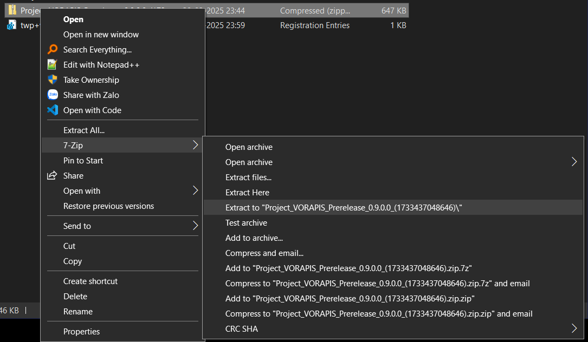
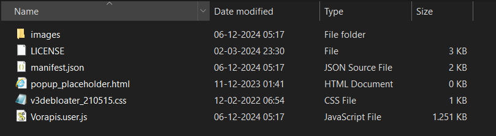
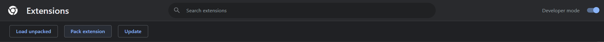
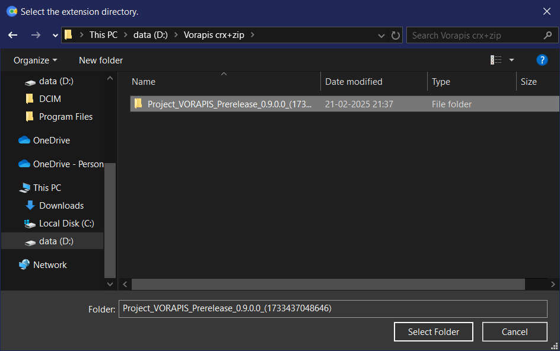
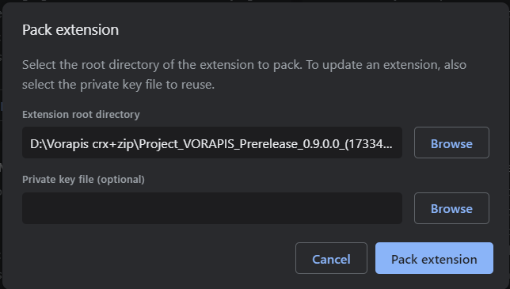
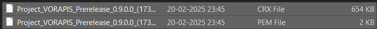
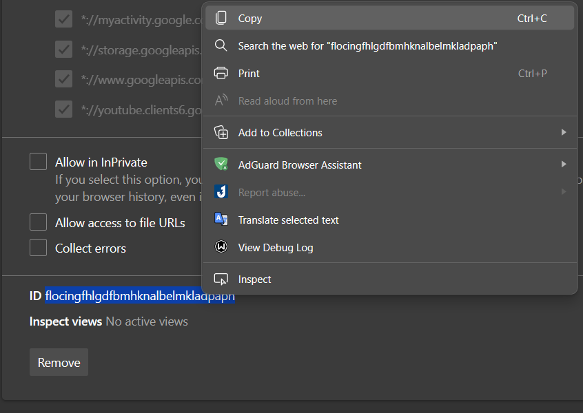

Xin chào cả nhà, lại là mình đây.

Dưới đây là hướng dẫn cách cài extension theo dạng sideload crx, cũng như là tạo file .crx từ file zip gốc để sideload.

Mình có những lí do mà thích cái việc cài qua file .crx này so với cái việc mà dùng “Load unpacked”:

* Đảm bảo an toàn về dữ liệu của extension. “Load unpacked” mặc dù tiện thật đấy, nhưng nếu như rơi vào 1 tình huống bất đắc dĩ mà làm cho folder gốc bị xoá đi hoàn toàn thì nó sẽ gây ra sự bực bội không hề nhỏ.
    
* Nó tiện hơn (đối với mình), chỉ việc kéo file crx vào và tận hưởng, ko phải locate folder loằng nhoằng.
    
* Có thể đem lên mobile sideload được (edge canary, kiwi browser,…)
    

Như vậy là đủ rồi, và sau đây là cách làm chi tiết:

## 1\. Tạo file .crx từ file.zip ban đầu

1. Chuột phải vào file zip, sau đấy chọn giải nén. Mình lấy file extension “Vorapis v3” làm ví dụ:
    
    
    
2. Khi này ta sẽ được thư mục với cấu trúc như hình dưới:
    
    
    
3. Vào chrome://extensions, xong đấy bật “developer mode” hay “Chế độ nhà phát triển” lên và chọn “Pack extension” như hình:
    
    
    
4. Ở cái popup đấy hãy chọn folder extension vừa giải nén xong:
    
    
    
    Sau khi chọn xong sẽ trông như hình dưới:
    
    
    
    Xong rồi bấm “Pack extension'“, khi đấy ta sẽ được 2 file như hình:
    
    
    
    Đến đây là xong bước đóng gói extension dạng .crx từ file zip ban đầu. Giờ ta sẽ sang bước tiếp theo:
    

## 2\. Cài đặt extension từ file .crx đã có (hay sideload .crx)

### <mark>Lưu ý quan trọng, đọc kĩ trước khi tiến hành:</mark>

* <mark>1 số trình duyệt chặn cài đặt extension từ bên ngoài, cần làm theo các bước sau đây nếu muốn dùng được trên đấy.</mark>
    
* <mark>Nếu trình duyệt có hỗ trợ sideload extension thì có thể bỏ qua các bước 2,3 của bài hướng dẫn dưới này.</mark>
    

1. Sideload extension đó lần đầu tiên, khi này nó sẽ cho phép như bình thường **nhưng sẽ không thể chạy được**. Như đã nói ở trên, các browser lớn chặn cài đặt extension bên ngoài “vì lí do bảo mật”
    
2. Khoan hãy vội xoá extension đấy, hãy copy extension id đấy, vì cái này rất cần thiết cho bước sau:
    
    
    
3. tạo 1 file registry trong notepad với nội dung như sau:
    
    ```plaintext
    Windows Registry Editor Version 5.00
    ; cho nay la list extension duoc phep cai dat len tren trinh duyet
    [HKEY_LOCAL_MACHINE\SOFTWARE\Policies\Google\Chrome\ExtensionInstallAllowlist]
    "1337"="bolggfoncklhniejomgplkjcllmnonbh"
    "727"="flocingfhlgdfbmhknalbelmkladpaph"
    
    [HKEY_LOCAL_MACHINE\SOFTWARE\Policies\Microsoft\Edge\ExtensionInstallAllowlist]
    "1337"="bolggfoncklhniejomgplkjcllmnonbh"
    "727"="flocingfhlgdfbmhknalbelmkladpaph"
    
    [HKEY_LOCAL_MACHINE\SOFTWARE\Policies\BraveSoftware\Brave\ExtensionInstallAllowlist]
    "1337"="bolggfoncklhniejomgplkjcllmnonbh"
    "727"="flocingfhlgdfbmhknalbelmkladpaph"
    ; cho nay la list nhung nguon duoc cai extension len tren trinh duyet
    [HKEY_LOCAL_MACHINE\SOFTWARE\Policies\Google\Chrome\ExtensionInstallSources]
    "1335"="https://github.com/*"
    "1336"="https://objects.githubusercontent.com/*"
    
    [HKEY_LOCAL_MACHINE\SOFTWARE\Policies\Microsoft\Edge\ExtensionInstallSources]
    "1335"="https://github.com/*"
    "1336"="https://objects.githubusercontent.com/*"
    
    [HKEY_LOCAL_MACHINE\SOFTWARE\Policies\BraveSoftware\Brave\ExtensionInstallSources]
    "1335"="https://github.com/*"
    "1336"="https://objects.githubusercontent.com/*"
    ```
    
    Đây chỉ là ví dụ mẫu của 1 file registry để chỉnh policy **để có thể cài extension theo ý muốn**. Trong này đã có sẵn **translate web pages** cũng như là **Vorapis v3** phía trên, và đã bao gồm cho *Google Chrome, Microsoft Edge cũng như là Brave*.
    
    Tạo xong nhớ save dưới dạng .reg sau đấy import file này luôn.
    
    Anh em nào dùng MacOS thì tham khảo cách ở [chỗ này](https://stackoverflow.com/questions/29916901/how-to-modify-chrome-extensioninstallwhitelist) xong đối chiếu với file reg này để thêm.
    
4. Khởi động lại trình duyệt (nếu có cho phép chạy ngầm thì vô cái icon trong taskbar nhấn chuột phải vào đó và chọn close, nếu ko đc thì kill hết task có liên quan trong Task Manager) và làm lại bước 1, lần này đảm bảo là sẽ chạy được êm ru.
    

Thế là đã xong việc sideload extension rồi đấy. **Nhờ ae chia sẻ bài này cho các ae khác chưa biết. Cảm ơn anh em đã theo dõi mình đến đoạn này. Mãi keo.**
