### Miếng trầu là đầu câu chuyện

Xin chào tất cả mọi người, mình là dh6k.

Chắc hẳn mọi người đã từng nghe đến Chrome Enterprise rồi phải không nhỉ?

Nói sơ qua thì đấy là 1 phiên bản không khác gì mấy so với phiên bản Chrome thông thường, nhưng mà mình có thể tha hồ mà tuỳ biến cũng như là apply các cái policy (lên đến hơn 200 cái), cũng như có thể sideload hay cài trước bất kì extension nào mà mình mong muốn. Ngoài ra có thể apply được luôn vô kênh cập nhật Extended của Chrome, giúp trì hoãn việc cập nhật nhanh lên đến bản Chromium mới hơn, cũng như là ổn định hơn trong quá trình sử dụng.

Biết là nó hay ho rồi đấy, nhưng mà làm thế nào để có thể được tận tay sử dụng, cũng như là tự mình quản lý cái Chrome Enterprise này và phân phối cho gia đình, người thân và bạn bè của mình sử dụng? Bài viết này sẽ là 1 cái hướng dẫn nho nhỏ từ 1 người cũng mới nhập môn cái kiểu này.

Bài viết sẽ chia làm nhiều phần do thời lượng thực tế khá là dài và mình cũng không có ý định viết hết trong 1 bài để tránh nhàm chán trong khi đọc.

Và chúng ta sẽ cùng bắt đầu với bước đầu tiên:

## Mua và quản lý Domain

Ở đây mình sẽ tin dùng Spaceship.

Trước hết cần phải giải thích Spaceship là cái gì đã. Spaceship chính là công ty con của Namecheap.com, vì nhận thấy cái trang web gốc khá là lỗi thời cũng như lợi thế cạnh tranh gần như không còn nữa, nên ban lãnh đạo của Namecheap đã quyết định thành lập ra Spaceship với 1 đường lối lãnh đạo khác biệt, cùng với giao diện dễ làm quen, dễ sử dụng và hợp thời hơn. Những ai tin tưởng dùng Namecheap thì việc qua Spaceship sẽ dễ dàng hơn thôi, cũng giống như là việc nhảy từ Oppo sang Oneplus hay là Realme vậy.

Sau đây là các bước mua domain giá rẻ:

1. Vào trang web của [Spaceship](https://www.spaceship.com). Sau khi bấm vào sẽ ra giao diện như hình:
    
    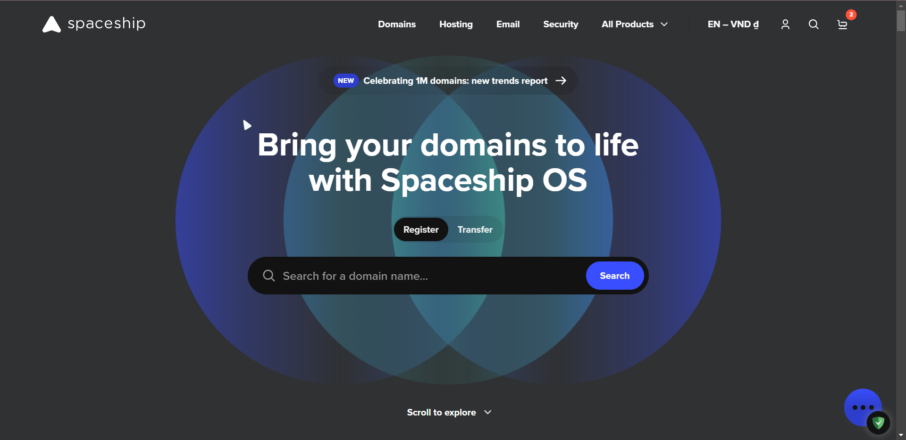
    
2. Nhập tên domain muốn mua vào cái ô "Search for a domain name..." ở hình trên. Có 1 mẹo mua domain để có thể tiết kiệm chi phí 1 cách tối đa, đó chính là **Sử dụng ID Game mà mình đang chơi** để múc domain với tên miền .xyz, mức giá quá phù hợp cho học sinh sinh viên (kể cả giá gia hạn cũng như vậy luôn, nếu chỉ có nhu cầu muốn tạo 1 email để dùng chrome enterprise thì như vậy là quá đủ rồi).
    
    Ví dụ cụ thể và sinh động: Ở đây bạn là người chơi 1 con game gacha như *Honkai: Star Rail,* và UID hiện tại của bạn là *802343568.* Vậy thì bạn nhập trong cái ô đấy là **802343568.xyz**, xong bấm Search là ra kết quả như hình dưới:
    
    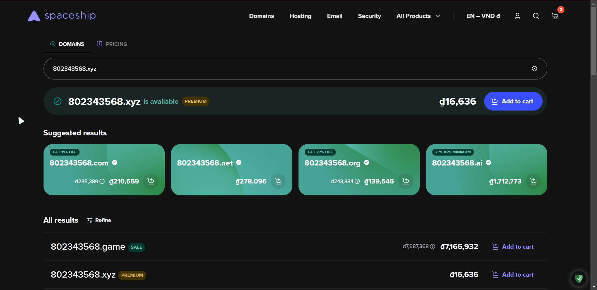
    
    Ở đây bạn chỉ cần làm theo hướng dẫn trong suốt quá trình đấy. Sau khi múc xong 1 năm thì sẽ có 1 mục unbox để các bạn có thể chọn cho mình 1 dịch vụ đi kèm. Ở đây bạn có thể mua thêm Spacemail với giá chỉ từ 17k/tháng là có 1 email riêng gán luôn với tên miền, còn nếu ko có kinh phí thì có thể dùng email forwarding để tạo Google Admin account.
    
3. Sau khi tậu xong domain mới rồi, tiến hành vào [Launchpad](https://www.spaceship.com/launchpad/). Giao diện sẽ như hình:
    
    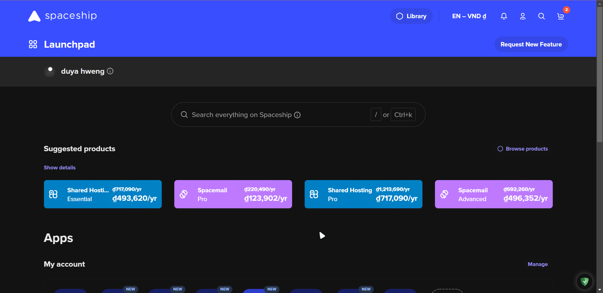
    
    Cuộn xuống xong chọn **"Domain list"** như hình dưới:
    
    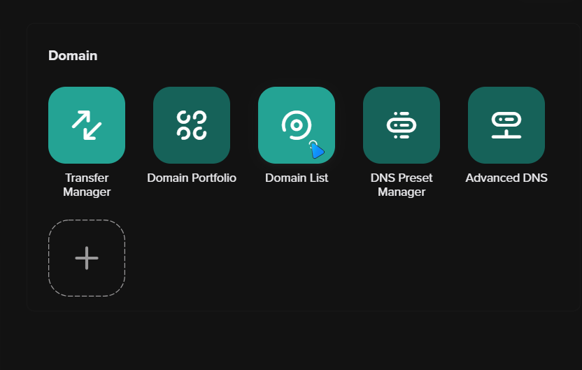
    
    Sau khi chọn xong sẽ có giao diện như hình dưới đây:
    
    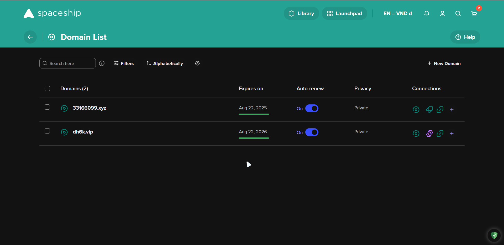
    
    Ở đây thì mình đã mua trước 1 domain theo cái mẹo phía trên, sử dụng UID Osu của mình xong kết hợp với đuôi **.xyz** và thế là thành 1 domain premium giá siêu rẻ. Trong hình của các bạn có thể khác với mình do cái các bạn mua là cái domain đầu tiên.
    
4. Bấm vào domain vừa mới mua, sẽ ra giao diện như hình dưới:
    
    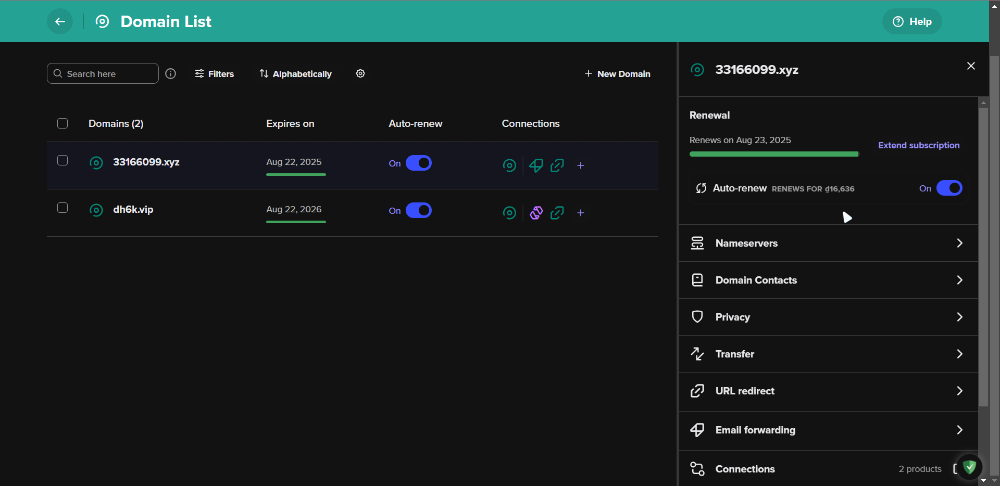
    
    Các bạn hướng đến cái chỗ bên phải, cuộn xuống dưới rồi chọn **"Email forwarding"**. Ở đây mình sẽ chỉ cho những ai ko có nhu cầu dùng mail hosting để tiết kiệm chi phí 1 cách tối đa. Sau khi chọn xong thì giao diện sẽ như hình dưới:
    
    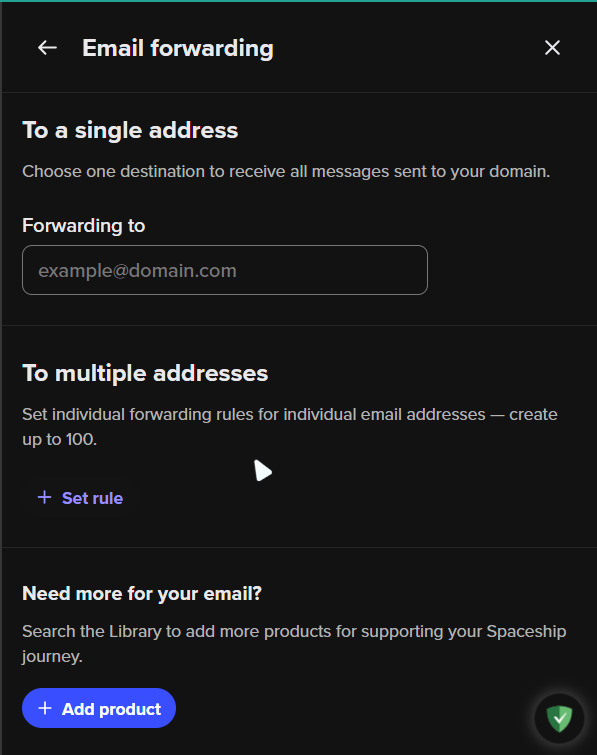
    
5. Ở đây các bạn nhập địa chỉ email cá nhân vào cái ô phía dưới chỗ **"Forwarding to"**, cái này phải là email **outlook/proton/duckduckgo** bởi vì khi nhập vào gmail sẽ bị lỗi *redirect too many times* rất khó chịu. Cũng đừng dùng mail 10 phút vì sẽ gần như ko thể khôi phục đc email về sau này.
    
6. Sau khi nhập xong thì bấm vào nút **"Set rule"**
    

Vậy là chúng ta đã xong bước đầu tiên, mua domain giá siêu rẻ và cấu hình mail forwarding. Bây giờ sẽ là bước tiếp theo

## Tạo tài khoản Google Admin và sử dụng gói Chrome Enterprise Core

1. Đầu tiên chúng ta sẽ vào [trang web này của google](https://enterprise.google.com/signup/chrome-browser/email?origin=cbcm&source=browsermgmt) để tiến hành tạo 1 tài khoản Google Admin và sử dụng gói Chrome Enterprise Core. Sau khi bấm vào link thì trang web sẽ như hình dưới:
    
    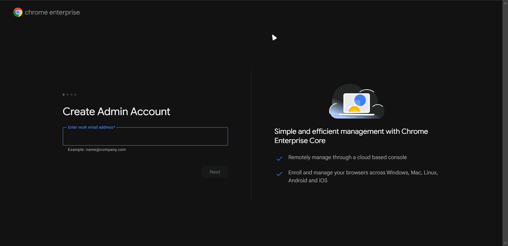
    
2. Nhập email với domain đã mua ở mục đầu, ví dụ ở đây là **"demo@331660999.xyz"**. Xong rồi bấm **"Next"**:
    
    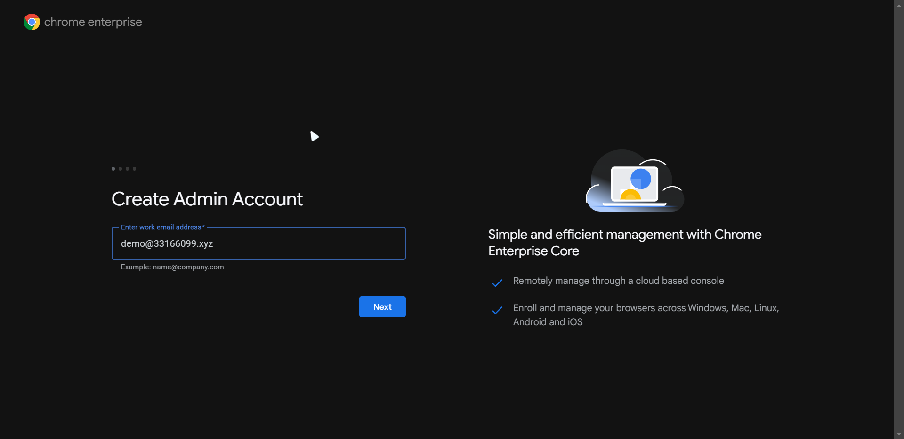
    
3. Khi xuất hiện hình này thì vào **hòm thư email cá nhân** đã nhập ở mục đầu tiên ở chỗ **"Forwarding to"**:
    
    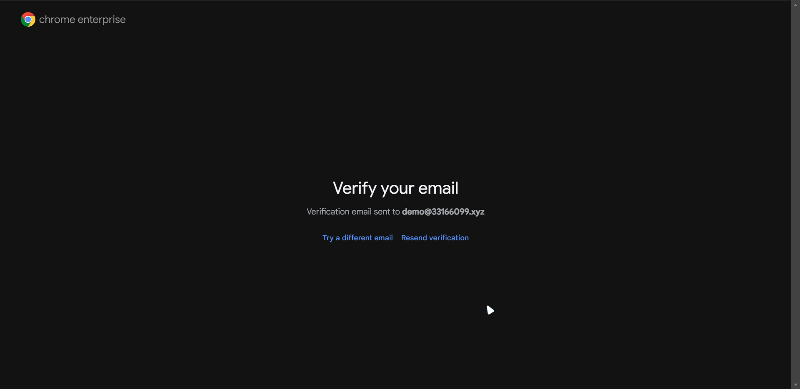
    
    Sau đó bấm vào **"Verify email address"** như hình bên dưới:
    
    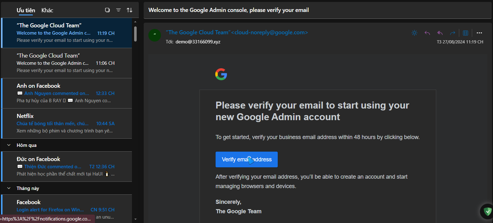
    

Tiếp đến sẽ là khai báo tên tuổi theo mẫu như hình dưới:

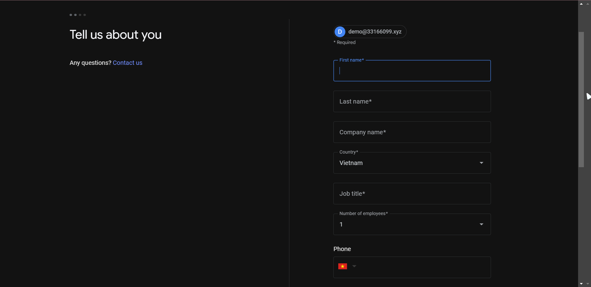

ở đây cứ khai báo như bình thường:

| Trường mục | Giá trị |
| --- | --- |
| First name | Tên |
| Last name | Họ |
| Company name | Nhập tên gì cũng được |
| Country | Cứ chọn đúng nơi mình sống |
| Job title | Nhập cái gì cũng được |
| Number of employees | Cứ để là 1 |
| Phone | Nhập số điện thoại của bạn vào |
| Communication preferences | 2 ô chọn là no |

Xong rồi bấm vào "Continue"

4. Sau đó thì chúng ta sẽ thấy màn hình như hình dưới. Bấm chọn **"Google Workspaces Essential Starter"** nếu có nhu cầu, ở đây t chọn vì nó có sẵn luôn. Sau đó bấm **Next**.
    
5. 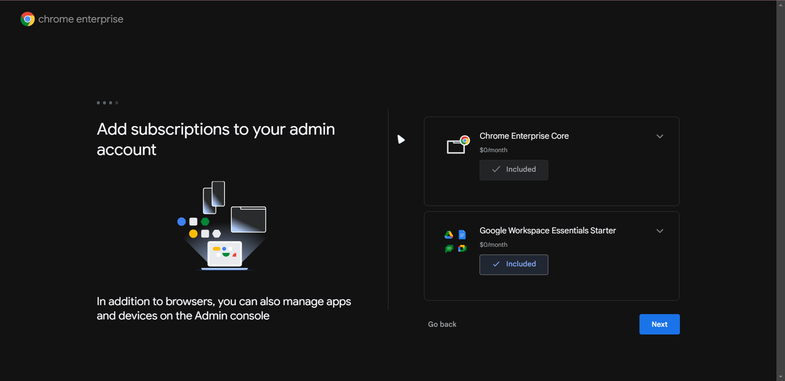
    
    Sau đó màn hình sẽ như hình dưới, lúc này chúng ta sẽ nhập mật khẩu rồi ấn vào nút "Next".
    
6. 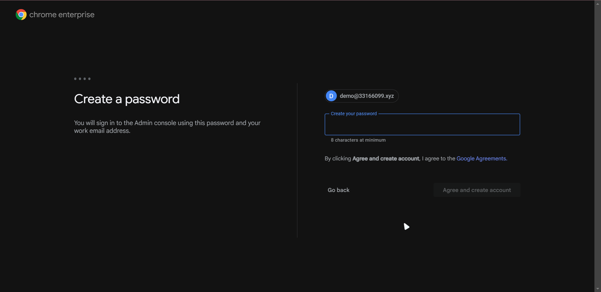
    
    Bấm xong đợi khi nào thấy hình này là thành công rồi.
    
7. 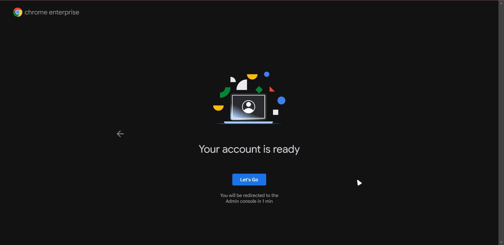
    

Vậy là chúng ta đã hoàn thành xong những thứ cơ bản, được coi là khởi đầu cho việc sử dụng Google Enterprise tự trồng tự ăn. Ở kì sau chúng ta sẽ cùng nhau học cách triển khai Chrome enterprise cho 1 máy tính, thiết đặt các chính sách.

Nếu thấy bài này hay thì hãy ủng hộ, cũng như là đẩy cho những ai chưa biết. Còn nếu thấy bài này có gì sai sót hay góp ý, hay có ý kiến gì cần thắc mắc thì hãy comment xuống phía dưới, hoặc cùng thảo luận trong server.
